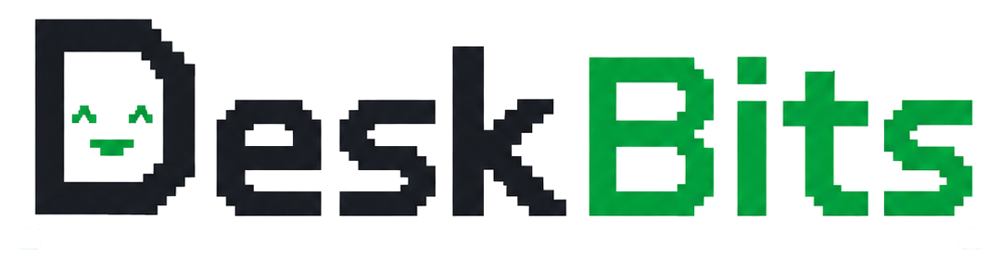
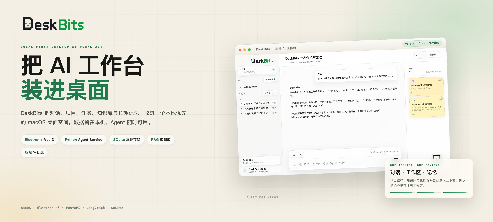
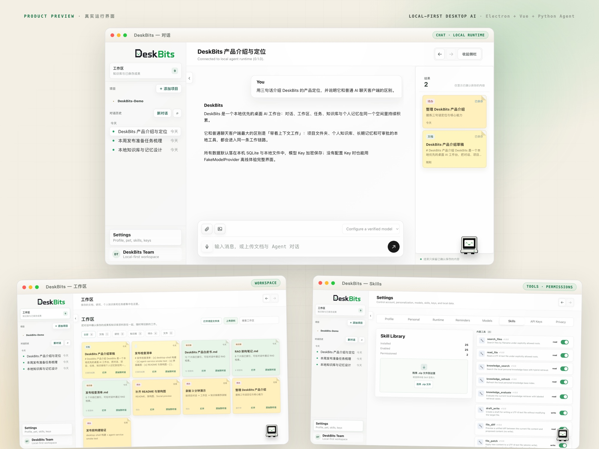
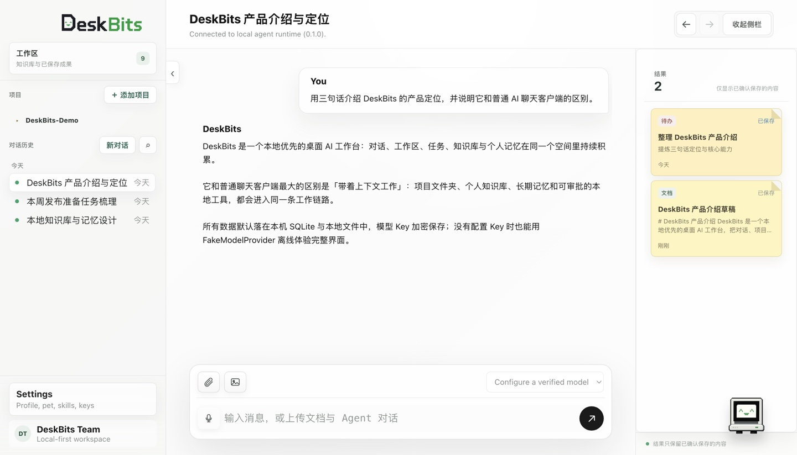
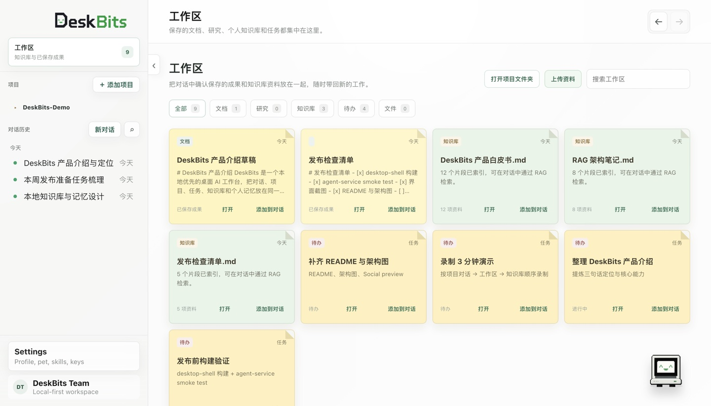
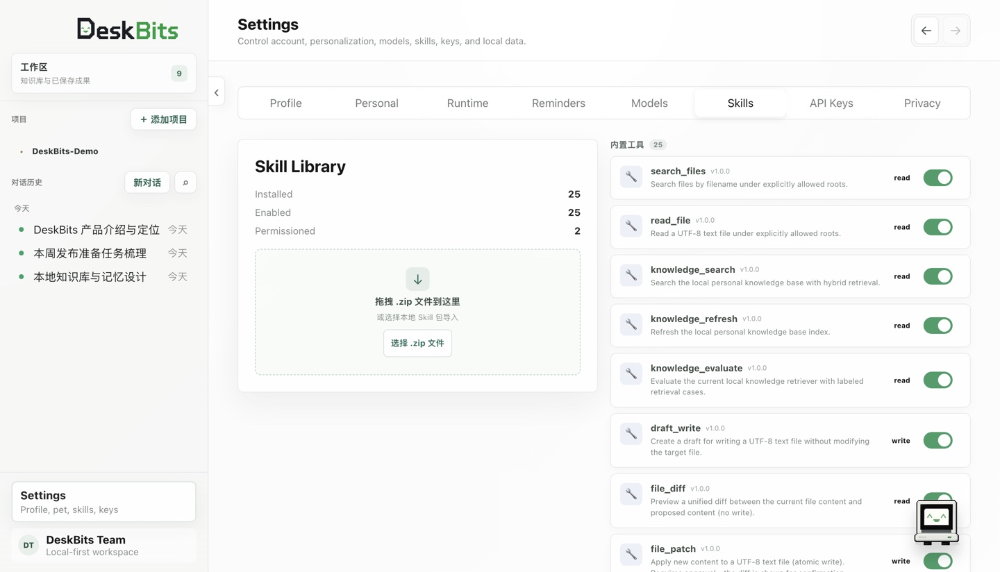
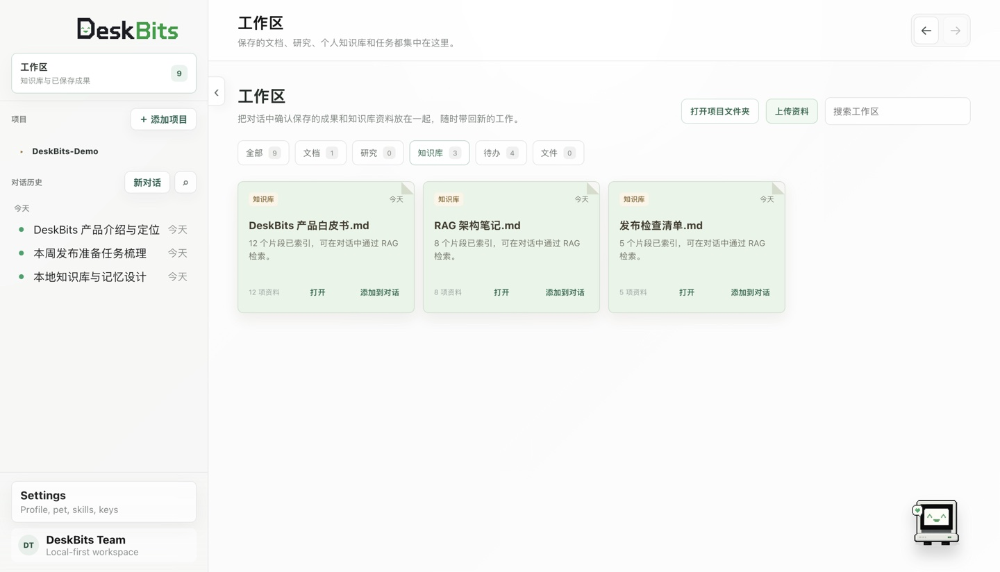
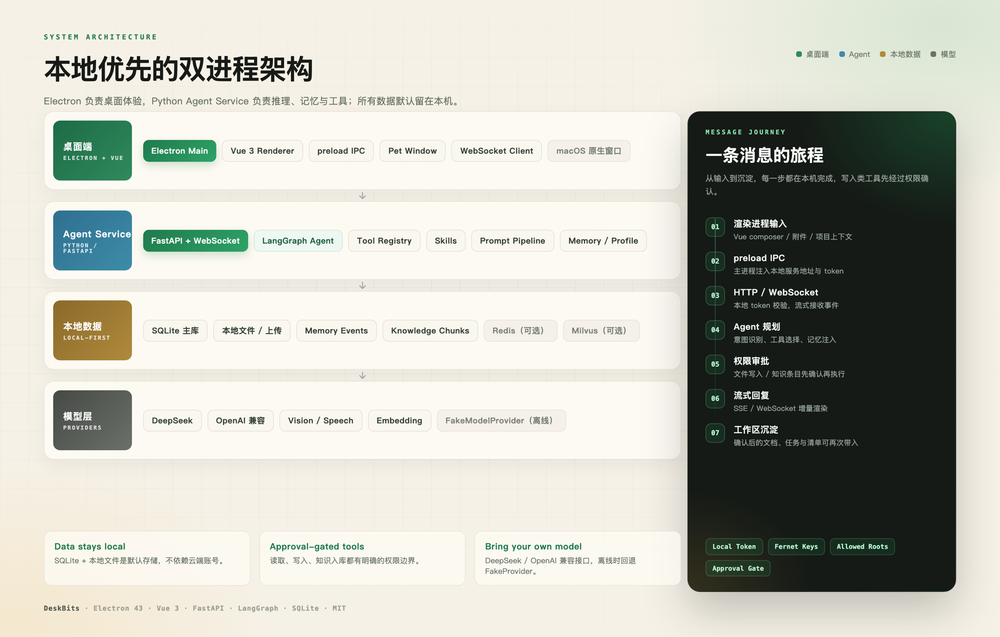

<p align="center">
  
</p>

<h1 align="center">DeskBits</h1>

<p align="center"><strong>Local-first desktop AI workspace</strong></p>

<p align="center">对话 · 项目 · 任务 · 知识库 · 长期记忆，一个 macOS 桌面空间</p>

<p align="center">
  
  
  
  
  
  
  <a href="LICENSE"></a>
</p>

<a href="assets/banner.jpg"></a>

> 把 AI 工作台装进桌面。数据默认留在本机，上下文跨对话持续积累。

DeskBits 是一个 macOS 桌面 AI 工作台：**Electron + Vue 3** 负责桌面体验，本地 **Python Agent Service** 负责推理、工具、记忆与知识库。它把对话、项目文件夹、工作区成果、任务提醒、个人知识库和长期偏好放进同一个空间，所有数据默认落在本机 SQLite 与文件中。

没有 API Key 也能启动：默认 `FakeModelProvider` 可离线体验完整界面；配置 DeepSeek / OpenAI 兼容模型后，再切换到真实推理。

## 为什么是 DeskBits

- **Local-first**：SQLite、本地文件与 JSONL 是默认存储，不依赖云端账号；Redis / Milvus 都是可选项。
- **One context**：项目结构、个人知识库、长期记忆与工作区成果，会自动进入下一次对话的上下文。
- **Agentic, not just chat**：工具注册表、Skills、文件读取 / diff / patch、Web 搜索与权限审批，组成可执行的 Agent 工作流。
- **Desktop-native**：原生窗口、悬浮桌宠、语音面板与本地服务生命周期，都是桌面应用的一部分。
- **Offline-friendly**：没有模型 Key 时回退 FakeProvider，开发、演示与 UI 调试不需要外部服务。

## 界面预览

<a href="assets/showcase.jpg"></a>

<details>
<summary>查看单页截图</summary>

| 对话 | 工作区 |
| :---: | :---: |
|  |  |
| **Skills / 工具权限** | **知识库** |
|  |  |

</details>

<sub>截图来自本机真实运行的 DeskBits，使用本地演示数据。</sub>

## 功能特性

| 模块 | 能力 |
| --- | --- |
| **对话** | 流式回复、WebSocket 事件、工具调用徽标、附件、语音输入、本地草稿 |
| **项目上下文** | 添加项目文件夹、文件树、项目内对话、README 与结构自动带入 |
| **工作区** | 文档、清单、研究、知识条目与任务卡片；确认保存的成果可再次带入对话 |
| **任务与提醒** | 任务清单、状态切换、截止时间；提醒调度与桌宠通知 |
| **知识库** | 上传 / 解析 / 分块 / 索引，RAG 检索、引用卡片与检索评估 |
| **记忆与画像** | memory items / events、用户画像、偏好与项目事实注入 |
| **Skills & Tools** | Skill 包导入、工具注册表、read / diff / patch、Web 搜索与网页抓取 |
| **权限与安全** | 本地 token、API Key Fernet 加密、allowed roots、写入前审批 |
| **桌宠** | 悬浮窗口、compact / conversation 两种模式、语音与权限提示 |
| **本地存储** | SQLite 主库、本地文件、JSONL trace；Redis / Milvus 可选 |

## 系统架构

<a href="assets/architecture.png"></a>

- **桌面端**：Electron 主进程管理窗口、桌宠与 Python 子进程；preload 通过 IPC 注入本地服务地址与 token；Vue 3 渲染界面。
- **Agent Service**：FastAPI + WebSocket，LangGraph 驱动 Agent，工具注册表、Skills、Prompt Pipeline、记忆与知识库都在本地进程内。
- **本地数据**：SQLite 保存会话、消息、任务、知识文档与记忆；原文件、trace、draft 落在本地目录。
- **模型层**：DeepSeek / OpenAI 兼容接口；没有 Key 时使用 FakeModelProvider。
- **安全边界**：本地 token、Fernet 加密 Key、allowed roots 与写入审批，把 Agent 的能力限制在明确范围内。

<details>
<summary>一条消息的旅程</summary>

1. **渲染进程输入**：Vue composer、附件或项目上下文。
2. **preload IPC**：主进程把本地服务地址和 token 注入渲染进程。
3. **HTTP / WebSocket**：请求到本地 Agent Service，token 校验后建立流式通道。
4. **Agent 规划**：意图识别、工具选择、记忆与知识库注入。
5. **权限审批**：文件写入、知识条目等操作先发审批卡片。
6. **流式回复**：事件增量返回，渲染进程实时更新。
7. **工作区沉淀**：确认后的文档、任务与清单进入工作区，下一次可继续使用。

</details>

## 技术栈

| 分层 | 技术 |
| --- | --- |
| 桌面端 | Electron 43、Vue 3.5、Vite 5、TypeScript、原生 IPC |
| Agent | Python 3.13、FastAPI、LangGraph、Pydantic |
| 存储 | SQLite、JSONL、本地文件；Redis / Milvus 可选 |
| 模型 | DeepSeek、OpenAI 兼容接口、FakeModelProvider |
| 文档 | pypdf、python-docx、python-pptx |
| 语音 | faster-whisper、Web Speech API |
| 工程 | pnpm / Corepack、uv、pytest、ruff |

## 快速开始

### 环境要求

| 依赖 | 版本 |
| --- | --- |
| macOS | 13+ |
| Node.js | 20+ |
| pnpm | 通过 Corepack 启用 |
| Python | 3.13 |
| uv | 最新版 |
| Docker | 可选，仅用于 Redis |

### 1. 克隆仓库

```bash
git clone git@github.com:Yannnn22/DeskBits.git
cd DeskBits
```

### 2. 安装依赖

```bash
# 桌面端
cd apps/desktop-shell
corepack pnpm install

# Agent Service
cd ../agent-service
uv sync
```

### 3. 启动

```bash
cd ../desktop-shell
npm run start:mac
```

`start:mac` 会：

1. 探测 Python 环境（`DESKTOPMATE_PYTHON` → `apps/agent-service/.venv` → `uv run python`）。
2. 自动拉起 `apps/agent-service/run.py`，分配随机端口与本地 token。
3. 把服务地址与 token 注入 Electron renderer。
4. 应用退出时回收 Python 子进程。

> [!NOTE]
> 默认使用 `FakeModelProvider`，不需要任何 API Key 就能体验界面。要接入真实模型，在 Settings → API Keys / Models 中配置，或在 `apps/agent-service/.env` 中设置 `DEEPSEEK_API_KEY` / `OPENAI_API_KEY`。

> [!TIP]
> 如果希望自己管理后端进程，可以设置 `DESKTOPMATE_AGENT_SERVICE_URL` 与 `DESKTOPMATE_AGENT_AUTH_TOKEN`，再启动 Electron：
>
> ```bash
> DESKTOPMATE_AGENT_SERVICE_URL=http://127.0.0.1:8000 \
> DESKTOPMATE_AGENT_AUTH_TOKEN=your-token \
> npm run start:mac
> ```

### 4. 可选：Redis

```bash
docker compose up -d
```

默认连接 `redis://127.0.0.1:16379/0`，可通过 `DESKTOPMATE_REDIS_URL` 覆盖。SQLite 模式不依赖 Redis。

### 5. 本地数据

默认数据目录为 `~/.desktopmate`，也可以通过 `DESKTOPMATE_APP_DATA_DIR` 指定：

```text
~/.desktopmate/
  desktopmate.db       # 会话、消息、任务、知识文档、记忆
  knowledge/           # 上传原文件与解析文本
  traces/              # run_*.jsonl
  drafts/              # 草稿
  settings/            # settings.json + Fernet 加密的 keys.enc
```

## 配置

Agent Service 的配置集中在 [`apps/agent-service/.env.example`](apps/agent-service/.env.example)。

| 环境变量 | 默认值 | 说明 |
| --- | --- | --- |
| `DESKTOPMATE_APP_DATA_DIR` | `~/.desktopmate` | 本地数据根目录 |
| `DESKTOPMATE_AUTH_TOKEN` | 随机生成 | 本地 HTTP / WebSocket token |
| `DESKTOPMATE_ALLOWED_ROOTS` | 空 | 允许工具访问的目录（`:` 分隔） |
| `DESKTOPMATE_REDIS_URL` | `redis://127.0.0.1:16379/0` | 可选 Redis |
| `DESKTOPMATE_MILVUS_ENABLED` | `false` | 是否启用 Milvus |
| `DESKTOPMATE_EMBEDDING_PROVIDER` | `fake` | `fake` / OpenAI 兼容 |
| `DEEPSEEK_API_KEY` | 空 | DeepSeek Key |
| `OPENAI_API_KEY` | 空 | OpenAI 兼容 Key |
| `DESKTOPMATE_INTENT_ROUTER` | `react` | `react` / `heuristic` |
| `DESKTOPMATE_WHISPER_MODEL` | `small` | 本地语音识别模型 |

> [!IMPORTANT]
> `.env`、`keys.enc` 与 `~/.desktopmate` 都只属于本机，不要提交到 Git。仓库只保留 `.env.example`。

## 项目结构

```text
DeskBits/
├── apps/
│   ├── desktop-shell/          # Electron + Vue 桌面端
│   │   ├── electron/           # 主进程、preload、Python 子进程管理
│   │   ├── src/                # Vue UI、API 客户端、样式与素材
│   │   ├── scripts/            # start-mac 启动脚本
│   │   └── package.json
│   └── agent-service/          # Python Agent Service
│       ├── src/desktopmate_agent/
│       │   ├── api/            # FastAPI / WebSocket / REST
│       │   ├── agent/          # LangGraph Agent 与工具
│       │   ├── knowledge/      # 文档解析、分块、检索
│       │   ├── memory/         # 记忆与画像
│       │   ├── settings/       # 本地设置与加密 Key
│       │   └── tools/          # 文件、Web、任务、权限
│       ├── tests/              # pytest 测试
│       ├── pyproject.toml
│       └── .env.example
├── docs/                       # 架构与发布说明
├── assets/                     # README 视觉素材
├── docker-compose.yml          # 可选 Redis
└── README.md
```

## 文档

| 文档 | 内容 |
| --- | --- |
| [Desktop Shell](apps/desktop-shell/README.md) | Electron / Vue 桌面端结构、开发与启动 |
| [Agent Service](apps/agent-service/README.md) | Python Agent、存储、模型、记忆与知识库 |
| [架构说明](docs/architecture.md) | 双进程架构、消息链路、数据与安全边界 |
| [发布说明](docs/release-notes.md) | v0.1.0 范围、验证结果与已知边界 |
| [环境变量示例](apps/agent-service/.env.example) | 全部可配置项 |

## 安全与隐私

- 对话与知识数据默认写在本机；配置云端模型或使用联网工具时，相关请求才会发往对应服务。
- 本地 HTTP / WebSocket 由随机 token 保护，Electron 通过 preload IPC 注入。
- API Key 使用 Fernet 加密保存在 settings 目录，接口只返回掩码。
- 文件工具受 `DESKTOPMATE_ALLOWED_ROOTS` 限制；写入类工具先走权限审批。
- 记忆写入会拒绝 `api_key` / `token` / `password` 等敏感内容。

## 后续计划

- 打通 Today / Files / Tasks / Knowledge / Chat 五个入口。
- 完善 `read → diff → patch → apply → confirm` 工具链与统一任务模型。
- 桌面端打包、自动冒烟与首次启动引导。
- 多 Agent 编排与更细粒度的项目权限。

---

<p align="center">MIT License © 2026 Yannnn22</p>
<p align="center"><sub>DeskBits v0.1.0 · Local-first desktop AI workspace</sub></p>
