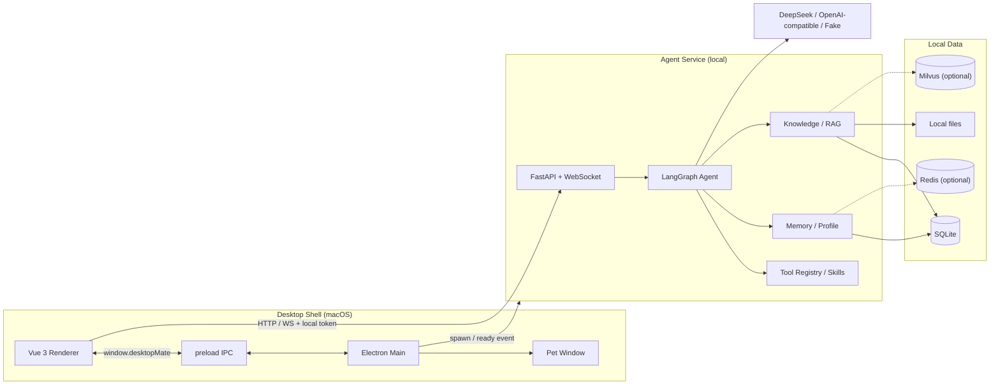

# DeskBits 架构说明

DeskBits 是一个本地优先的 macOS 桌面 AI 工作台，由两个进程组成：

- **Desktop Shell**（Electron + Vue 3）：窗口、桌宠、渲染与交互。
- **Agent Service**（Python + FastAPI）：Agent 推理、工具、记忆、知识库与本地存储。

两者通过本机 HTTP / WebSocket 通信，不依赖云端账号。

## 进程与边界



### Desktop Shell

| 部分 | 职责 |
| --- | --- |
| `electron/main.cjs` | 创建主窗口 / 桌宠窗口，管理 Python 子进程生命周期，读取本地设置 |
| `electron/preload.cjs` | 通过 `contextBridge` 暴露受控 IPC API |
| `electron/agent-service.cjs` | 探测 Python 环境、spawn Agent、解析 `desktopmate_ready` |
| `src/` | Vue 3 UI、API 客户端、对话 / 工作区 / 设置 / 桌宠 |

### Agent Service

| 包 | 职责 |
| --- | --- |
| `api/` | REST、WebSocket、健康检查、设置、会话、任务、提醒、知识库、Skills |
| `agent/` | LangGraph Agent、意图路由、工具调用与流式事件 |
| `tools/` | 文件读写、diff / patch、Web 搜索、任务、委派、权限 |
| `memory/` | 短期上下文、长期记忆、用户画像、事件日志 |
| `knowledge/` | 上传、解析、分块、索引、检索与评估 |
| `settings/` | 本地设置与 Fernet 加密的 API Key |
| `storage/` | SQLite 表结构、迁移与统计 |

## 一次对话的链路

1. Renderer 读取 `window.desktopMate.getAgentServiceUrl()` 与 token。
2. 通过 HTTP 创建 / 恢复会话；通过 WebSocket 发送消息。
3. Agent 识别意图，选择模式（chat / agent / plan）与工具。
4. 需要写入文件或保存知识条目时，后端发出 `permission_request` 事件。
5. Renderer 展示审批卡片；确认后工具才真正执行。
6. 模型输出以增量事件返回，Renderer 实时渲染。
7. 确认保存的文档、任务、清单进入工作区；记忆与画像异步更新。

## 本地数据布局

默认根目录为 `~/.desktopmate`，可用 `DESKTOPMATE_APP_DATA_DIR` 覆盖：

```text
~/.desktopmate/
  desktopmate.db          # sessions / messages / tasks / documents /
                          # chunks / memory_items / memory_events /
                          # profile_facts / settings
  projects.db             # 项目文件夹引用
  knowledge/
    originals/            # 上传原文件
    extracted/            # 解析后的文本
  memory/                 # memory_events.jsonl
  traces/                 # run_*.jsonl
  drafts/                 # 草稿
  settings/               # settings.json + keys.enc
```

SQLite 是默认存储；Redis 仅用于可选的跨进程记忆缓存，Milvus 仅用于可选的向量检索。

## 安全边界

- **本地 token**：HTTP / WebSocket 必须携带 token；Electron 自动注入，外部模式可显式配置。
- **API Key 加密**：Fernet 加密保存在 `settings/keys.enc`；接口只返回掩码。
- **Allowed roots**：文件工具只能在 `DESKTOPMATE_ALLOWED_ROOTS` 指定的目录内工作。
- **审批门**：写入、知识保存等有副作用的工具需要用户确认。
- **敏感内容拒绝**：记忆写入会拒绝 `api_key` / `token` / `password` 等字段。

## 降级与失败模式

| 场景 | 行为 |
| --- | --- |
| 没有模型 Key | 使用 FakeModelProvider，界面与工具链仍可运行 |
| Python 环境缺失 | `start:mac` 回退 `uv run python`；否则提示启动失败 |
| Redis 不可达 | 使用 SQLite 记忆，不影响核心对话 |
| Milvus 不可用 | 使用 SQLite / fake embedding；向量检索降级 |
| 写入未审批 | 工具不执行，前端保留审批卡片 |

## 扩展点

- 新增工具：在 `tools/registry.py` 注册，声明风险等级与权限。
- 新增 Skill：以 zip 包导入，或复制文件夹到本地 skills 目录。
- 新增模型：通过 OpenAI 兼容接口配置 `provider / base_url / model`。
- 新增视图：在 `src/App.vue` 的 `PrimaryView` 与 `activeView` 中扩展。
